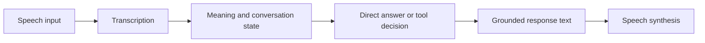

# Why a Large Corpus Did Not Immediately Produce a Reliable Twi Assistant

[Series index](README.md) | [Next: What is actually in the corpus](02-four-collections.md)

**Written 16 October 2026. Research evidence through 11 October 2026.**

## The Product Question

Ghana Health AI began with a straightforward expectation: a person should be
able to speak naturally in Twi, be understood, and receive a useful spoken
answer in the same language. They should be able to continue a conversation,
correct a detail, ask a follow-up, or ask for help finding something to buy.
The interface should not require them to understand the machinery behind it.

That expectation is much stronger than a recogniser producing plausible words,
a model assigning a HEALTH label, or a synthetic voice reading fluent-looking
text. A person can say that a child is unwell, clarify what they meant, and
switch into English for one sentence. A usable system has to keep the right
person, symptoms, timing, uncertainty, and conversation state throughout.

The research objective consequently became broader than medical classification:
**adapt a general-purpose foundation model to understand and generate Twi,
while retaining useful English and general capabilities**. Health education is
an intended specialisation. Commerce, calculation, and tool use are further
specialisations, not reasons to replace general language understanding with
a narrow set of templates. [Evidence E01](evidence/README.md#e01-research-objective-and-current-graph)

## Separate the Product Layers Before Diagnosing Them

A voice system has several independently fallible stages:

Good transcription does not prove that the language model understands the
transcript. Correct intent classification does not demonstrate that it can
write an answer. A natural voice can make a wrong answer sound more credible.
And an attractive interface cannot correct a model that loses a negation.

This distinction also matters for attribution. If a research adapter produces
an interpretation but an external model writes the final answer, the user is
evaluating a composite system. It is not evidence that the adapter can answer
independently. Our current research target requires the adapted model to
produce its own responses, with model identity and tool provenance visible
in the evaluation record. A hidden proprietary fallback would defeat that
measurement even if it made the demonstration smoother.

Speech remains important, but the current collection pass deliberately does
not modify ASR, TTS, or production routing. It works on text supervision and
understanding. Historical voice measurements are reported separately in
[Article 4](04-benchmarks.md#speech-diagnostics-are-separate).

## What the Experiments Actually Established

The project has not simply avoided training. It has trained and evaluated
multiple candidates, compared open-weight foundations, tested annotation
teachers, and preserved negative results.

A small MiniCPM pilot learned an interpretation format: valid structured
outputs rose from **0/24 to 22/24**. Yet its intent agreement against the
uncalibrated labels was **13/24**, below a **14/24** majority-class baseline.
Its Twi response similarity also declined. It learned much of the requested
format without demonstrating the intended understanding. [E07](evidence/README.md#e07-early-response-pilots)

A comparison of Qwen's 9B base with an Afrique 50-language continued-pretraining
checkpoint showed a different split. On 32 translation pairs, English-to-Twi
chrF++ rose from **9.11 to 41.47**. On 450 Twi AfriXNLI development cases,
correct selections rose only from **211 to 214**. English selections fell
from **392 to 361**. Better translation similarity on that small sample was
not equivalent to broad understanding or retention. [E08](evidence/README.md#e08-foundation-and-early-adaptation-comparisons)

Most recently, the October response run completed an epoch over **21,170
training examples**. Twi validation loss fell from **2.232587 to 1.459290**.
But the fixed development suite had **three repetition flags before training
and five afterward**. Greeting, negation, and multi-turn failures remained.
The checkpoint was not promoted. [E11](evidence/README.md#e11-october-response-training)

These are different experiments with different data and objectives. They must
not be combined into a single improvement curve. Together, however, they
explain why training completion, valid JSON, lower loss, and natural-looking
language were rejected as sufficient evidence of progress.

## The Data Problem Was More Specific Than "We Need More Data"

The frozen source inventory contains **1,178,118 rows**. That is substantial
material to inspect, but not a million verified conversational targets.
Different portions are synthetic, lexical, short transcription fragments,
parallel sentences, source QA, or conversation messages. Some are protected
evaluation material. Some have unreliable translations. Some are missing
their original context. [E02](evidence/README.md#e02-source-inventory-and-stage-capacity)

The corrected language-learning export made this concrete. Its training view
contained **42,124 records**, but **25,378 were vocabulary entries**. The
non-lexical portion contained only **457,120 content tokens** under its pinned
counting tokenizer. Vocabulary has value, but it is not the same exposure as
paragraphs or coherent conversation.

An even sharper contrast appeared in a source-preserved response collection:
**108 Twi QA training examples contained only 625 assistant-content tokens**.
Of those answers, 104 were five words or fewer. Counting English instructions
and passages around them had previously made the Twi response capacity look
much larger. The tokens the model sees are not necessarily the tokens it is
trained to produce. [E02](evidence/README.md#e02-source-inventory-and-stage-capacity)

This is why the project now distinguishes an inventory, a usable view, a
training objective, and a measured target-token budget. The relevant question
is not merely "How many rows do we own?" It is "What behaviour does the
supervision actually teach, in which language, with what evidence?"

## Fixing Known Errors Was an Execution Obligation

One uncomfortable finding was that some complete correction proposals already
existed but had not been applied to the working dataset. Preserving originals
had become confused with leaving defects untouched everywhere.

Those are not the same requirement. The original should remain immutable;
the corrected derivative should actually contain the correction, with a
traceable before/after record. A proposal that never reaches a working copy
does not improve a future training target.

The October 11 pass addressed that gap across the **52,002-record instruction
collection**. It applied 24 existing complete edits, introduced narrow
food-term repairs in 37 other records, and removed false empty-input markers.
These are concrete changes, not another promise that an annotator will
eventually populate fields. They also remain limited changes: partial word
repairs are not certification of an entire answer. [E04](evidence/README.md#e04-applied-working-corrections)

## Retrieval Was Not a Substitute for Understanding

The project also tested source-backed translation support. A pinned Gemma
checkpoint received complete English context and retrieved material drawn
from existing parallel sources. Two routes were compared: fresh translation
and post-editing of the existing Twi.

All **88 outputs** satisfied the structural contract. Both routes still
changed meaning. Findings included person changes, wrong ingredients, and
technical terminology being translated into unrelated concepts. There were
also incorrect explanations of supposed source defects. The method failed
qualification for bulk use. [E12](evidence/README.md#e12-annotation-and-correction-qualification)

This does not establish that retrieval is useless. It establishes that, in
this experiment, supplying relevant context did not make this checkpoint a
reliable Twi correction system. Similarly, searching a catalogue can ground
a price, but it cannot undo a misunderstanding of whether the user wants to
buy an item at all.

## What Exists Now

There is now a source-preserving research pipeline with versioned artifacts,
explicit correction records, protected-group handling, independent language
views, review queues, reconstruction checks, and private checksum-verified
backups. The current instruction queue contains **674 distinct work items**
rather than several overlapping lists masquerading as independent volume.

There are also real unresolved gaps: semantic quality, natural multi-turn
Twi, teacher reliability, specialised health scope, and a defensible admission
decision for corrected training targets. The latest pass added **zero training
admissions**, and the next node is inspection of the unflagged pool.

The value of this work is not that the data problem has disappeared. It is
that its components are becoming identifiable and actionable. A missing
English reference can be recovered. A mistaken record type can be corrected.
A known bad target can receive a source-bound replacement. A disputed meaning
can be sent for focused review. An unresolved case can remain outside training
without disappearing from the accounting.

## The Research Claim We Can Defend Today

We have not established a competitive independent Twi assistant, a winning
foundation, or a clinically qualified model. Nor have we proved that data
quality explains every failure; base capability, tokenisation, optimisation,
decoding, and interference between objectives remain possible contributors.

We have established several useful negatives, recovered missing source
evidence, measured important supervision gaps, and implemented a reproducible
way to repair targets without destroying their history. The next claim must
come from a changed, qualified dataset and a controlled before/after model
comparison, not from the number of jobs launched or the size of an inventory.

[Next: What is actually in the corpus](02-four-collections.md)
