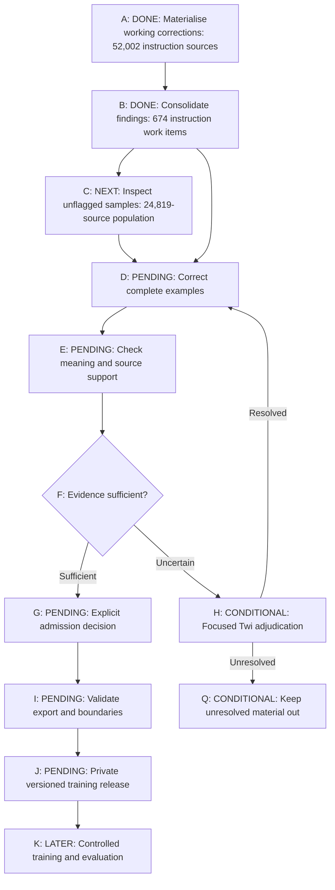
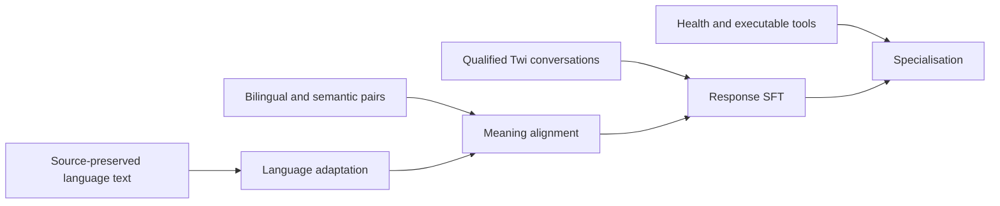

# What We Need Before the Next Twi Fine-Tuning Run

[Series index](README.md) | [Previous: Benchmarks](04-benchmarks.md)

**Plan relative to the 11 October 2026 checkpoint. Not a claim of subsequent execution.**

The previous response run lowered validation loss and left important conversational failures unresolved. Running the same recipe again would be easy. Learning whether better supervision changes those failures requires a more deliberate handoff.

The next milestone is a versioned training release whose sources, corrections, exclusions, and target tokens can be inspected. Only then can we compare a candidate with the untouched foundation and the saved response checkpoint under matched conditions.

This is the plan from the October 11 checkpoint. It explains how the completed repair work leads to a controlled experiment; it does not report that the experiment has run.

## The Immediate Objective

Produce a versioned, quality-qualified training release that addresses the
observed Twi meaning and response failures, then compare its effect against
the unchanged foundation and the saved failed response baseline.

The current pass is a dataset-preparation pass. It does not authorise a new
training job, production replacement, ASR/TTS change, or public dataset upload.
Its success criterion is usable stage-specific data with visible gaps, not
every field filled or every record declared approved.

## The Execution Graph

The graph is a dated execution map. **A and B are complete. C is next.**
Other nodes are pending or conditional. The persistent clickable dashboard
requested for the project had not been built at this checkpoint.

The B-to-D edge represents a data dependency, not permission to skip C. The
documented execution order is sequential: consolidate, inspect the unflagged
population, then combine known and new findings in the next correction batch.
[E01](evidence/README.md#e01-research-objective-and-current-graph)

## Close C With Inspection, Not Just a Sample File

"Unflagged" currently means no findings in the queues selected for
consolidation. It does not mean that no earlier audit has ever raised a concern,
or that the text has passed a semantic review.

Before reading outcomes, the next step is to specify a reproducible,
source-group-aware sampling design. It should expose relevant source families,
answer lengths, context presence, and meaning risks. Earlier source-level
triage must accompany the selected examples.

Two purposes should remain distinct:

- A diagnostic sample deliberately seeks failure patterns. It is useful for
  improving correction rules but cannot produce an unweighted population
  error estimate.
- A representative audit estimates quality in a defined population. It needs
  a recorded selection design, denominators, appropriate weighting where
  applicable, and uncertainty reporting.

No sample size or confidence interval is claimed here because that design
has not yet been executed. Closure requires the plan, actual selected full
examples, inspection findings, and measured coverage. Merely creating a file
of sample IDs does not complete the node.

## Correct the Full Example

The next correction batch must treat instruction, context, and answer together.
Each proposed change should identify the original defect, the supporting
reference, the replacement text, and remaining uncertainty.

The meaning check should ask:

| Dimension | Question |
| --- | --- |
| Actor and experiencer | Is the same person doing or experiencing the same thing? |
| Action and object | Is buying still buying, and is the requested object unchanged? |
| Negation and modality | Are refusal, desire, obligation, possibility, and uncertainty retained? |
| Time and quantity | Are sequence, dates, amounts, units, and corrections preserved? |
| Context | Does the answer use earlier turns without inventing missing facts? |
| Completeness | Were important conditions or qualifications omitted? |
| Source support | Does the reference actually support the answer, or need its own correction? |
| Task compliance | Does the output satisfy the requested format or executable operation? |
| Naturalness | Is the wording intelligible and appropriate in the relevant Twi variety? |

Executable checks can verify a calculation or catalogue result. Source matching
can verify an evidence span. Neither can settle every ambiguity of natural
language. Agent assessment and model agreement remain distinct from native
review.

## Use Human Review Where It Changes the Decision

The owner should not have to manually relabel tens of thousands of rows.
Human effort is most valuable for representative quality assessment,
meaning-critical disagreements, ambiguous wording, dialect, and naturalness.
It should improve and calibrate the correction process rather than substitute
for missing source recovery or mechanical validation.

A focused review record should show the complete source context, original
target, English reference, proposed full correction, specific concern, and
alternative where a genuine disagreement exists. A third alternative is
justified by a supported correction, not by a desire to fill three columns.

A small positive review must not become blanket approval of unrelated data.
Unresolved cases keep their evidence and exclusion reason. Health content
also needs its own source and domain assessment; a linguistically faithful
translation can still reproduce an unsupported medical claim.

## Define the Handoff Before the Next Run

Each stage export needs a clear contract:

| Artifact | Required content |
| --- | --- |
| Dataset card | Intended stage, source scope, restrictions, coverage, synthetic share, quality status, and limitations |
| Manifest | Immutable source/code/tokenizer identities and checksums |
| Source accounting | Every selected source accepted, excluded, pending, or review-needed |
| Training views | Exact inputs, targets, roles, source IDs, and source-group membership |
| Review snapshot | Decisions bound to the actual source and proposal versions |
| Split protection | Upstream holdouts, related versions, diagnostic reservations, and cross-collection overlap handling |
| Exposure report | Unique sources and supervised tokens by task, language, topic, and target type |
| Verification report | Schema, reconstruction, duplicate, mask, target-completeness, and boundary checks |
| Remaining work | Explicit gaps that the export does not resolve |

The existing four collections provide the organisational structure. They do
not establish that every training stage is ready. English replay remains
explicit. Specialised health and tool material stays separate from general
conversation so mixture weights can be inspected rather than inferred from
row totals.

## Make the Next Training Comparison Interpretable

The project has a pinned Qwen3.5-9B foundation and saved response baseline.
Reusing them as controls is different from declaring Qwen the final winning
base. The immediate comparison should make the effect of changed supervision
observable rather than changing model family, dataset, objective, and decoding
at once.

The following is a proposed comparison structure, not a submitted experiment:

1. Keep the untouched foundation and saved failed response checkpoint as controls.
2. Train a candidate on the qualified response release with an explicit English
   retention mixture and measured supervised-token exposure.
3. Hold inference prompts, response budgets, tool interfaces, and scoring
   procedures fixed for the paired comparison.
4. Only after that comparison is interpretable, test the additional contribution
   of language adaptation or semantic alignment using the same response stage.

The broader curriculum remains a hypothesis:

It must be compared with simpler alternatives such as response SFT alone.
The diagram is not proof that the longest training sequence will perform best.

## Evaluation Must Follow the Intended Behaviour

The model should be tested on faithful meaning, direct Twi responses, naturalness,
instruction following, multi-turn correction, code-switching, grounded actions,
uncertainty, and English retention. Existing failure cases remain development
regressions; repeatedly inspecting them does not make them fresh test data.

Conversation rollouts must feed each model its own previous reply. Teacher-fed
histories can conceal an error that the model itself introduced earlier.
Tool tests must execute allowed actions and verify that the final answer
uses the returned result. Emitting plausible function syntax is not enough.

A final evaluation needs source-group-disjoint material and representative
native assessment. Any numerical advancement threshold should be declared
before outcome inspection. Publication should include negative cases and
uncertainty, not only a selected screenshot or improved loss.

## Efficient Compute Without Hiding Unfinished Work

Source recovery, exact joins, deduplication, type checks, and many executable
checks do not require a large GPU. Qualification should precede bulk generation.
Completed calls should be inspected by receipt rather than resubmitted after
a client interruption. Model loading and warmup should be measured separately
from useful generation or training throughput.

There is no credible completion date to derive from an 88-output qualification
mix or an old GPU loading time. After a qualified production batch, estimate
remaining time from its actual accepted output rate, length distribution,
retry needs, and review workload. Report unfinished partitions explicitly.

The next meaningful milestone is not another checkpoint name. It is a qualified
release that changes the supervision, followed by a controlled run whose actual
Twi responses improve without hiding new failures behind lower loss.

[Return to the series index](README.md)
