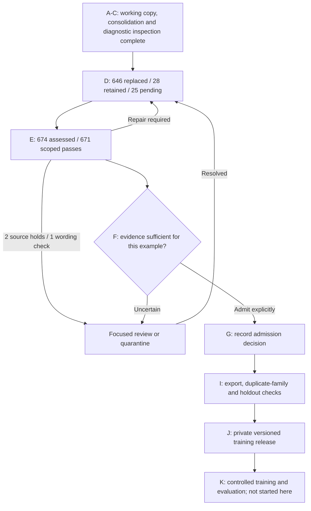

# From an Inspection Queue to 674 Complete Meaning Handoffs

[Series index](README.md) | [Historical training plan](05-next-training-stage.md) | [Checkpoint data](evidence/checkpoint-20261020.json)

**Written:** 21 October 2026. **Sealed research checkpoint:** D49 / E48, 20 October 2026.

## What Changed Since the First Articles

The original series stopped with source recovery and queue consolidation
complete, but diagnostic inspection and full-example correction still ahead.
Those articles remain a historical account. This update documents the work
actually completed since then, without rewriting the old experiments or
presenting data repair as a new model result.

The immediate problem was not simply too few rows. Some Twi targets changed
the actors, objects, quantities or requested task. Some English references
were themselves incomplete or unsupported. Training on a faithful translation
of a defective answer would preserve the wrong supervision.

The work therefore treats the instruction, supplied context and full answer
as one example. It preserves the original English and Twi, records the defect,
authors a complete replacement where justified, and checks that exact target
before any admission decision.

## The Accounting Now

| Measure | D49 / E48 count | Interpretation |
| --- | ---: | --- |
| Working instruction sources | 52,002 | Accounted-for working view, not accepted training data |
| Protected or excluded records | 26,509 | Unchanged by these corrections |
| Targeted queue | 699 | 674 consolidated work items plus 25 diagnostic handoffs |
| Distinct originals replaced | 646 | Full proposed replacements; revisions do not add new originals |
| Retained examples | 28 | 17 current targets retained plus 11 legacy retention decisions |
| Pending correction items | 25 | 13 source-reference adjudications and 12 contextual examples |
| Current full handoffs assessed | 674 | 646 replaced plus 28 retained |
| Scoped agent passes to admission review | 671 | Not independent validation or training approval |
| Meaning-stage source holds | 2 | Separate from the 25 pending correction items |
| Focused Twi wording check | 1 | Also separate from the 25 pending correction items |
| Explicit corrected English derivatives | 122 | Originals preserved; not silently relabelled as original references |
| Training admissions from this pass | 0 | No training release or new model gain claimed |

Node C selected and inspected 29 complete examples using a frozen 12-stratum
diagnostic plan. It produced 25 additional source-bound handoffs. That is
diagnostic coverage, not a representative accuracy estimate: the remaining
24,790 uninspected sources in that sampling pool are not certified by it.

Since D33, 188 additional original examples have been replaced. Three later
rework revisions are not three additional source examples. The newest D49
batch accounts for nine replacements, moving the pending count from 34 to 25.

The 674 handoffs are not all ordinary conversations. Their recorded target
types are 355 language exercises, 259 Twi-prose examples, 39 code exercises,
14 literal labels, one literal structure and six legacy-unlabelled examples.
This distinction matters when selecting training mixtures and measuring actual
Twi assistant-token exposure.

## Correcting the Source Without Losing It

A translation-only workflow assumes that the reference answer is usable.
The correction pass found cases where that assumption fails. The explicit
source-adjudication path records the original source identity, the reason for
the change, a separately labelled English derivative, the corresponding Twi
target, supporting evidence and unresolved limitations.

The latest nine examples concern food, cooking and process explanations.
They exposed truncated instructions, ingredient substitutions, misleading
measurement equivalences, lost process distinctions, unsupported cultural
generalisations and a restaurant review presented without a fictional framing.
These examples illustrate the repair categories; they are not a newly measured
error distribution across the corpus.

Where a missing procedure was completed, the completion is labelled authored,
not recovered. Where the English reference changed, the review interface shows
the corrected English beside the proposed Twi and keeps the original English
separately accessible. External evidence is attached to the claim it supports;
a source link does not certify every sentence in the example.

No recipe testing, clinical certification or independent native-language
validation is implied. Some current targets still contain unnecessary repair
commentary or naturalness concerns. Those remain explicit admission-stage
issues, rather than being hidden behind a successful structural check.

## What the Meaning Checks Establish

E48 contains 674 assessments bound to the current complete handoffs. It checks
task and context, actors and negation, quantities and uncertainty, completeness,
source support and naturalness limits. When the English reference is corrected,
the assessment also binds that derivative. An earlier assessment cannot silently
approve a different replacement.

The result is 671 scoped passes, two source holds and one focused Twi check.
There are no currently unassessed handoffs in this checkpoint. This does not
close E for the 25 examples still awaiting correction.

These are same-agent source comparisons. The agent both authors repairs and
assesses them, so the outcomes are not independent accuracy measurements. In
particular, **671 out of 674 must not be reported as model accuracy**. A focused
human confirmation of one phrase likewise does not approve the whole example
or all remaining Twi. The next gate must use the actual evidence and retain
unresolved uncertainty.

## The Current Execution Map

The authenticated [review page](https://ghanahealth.serendepify.com/research/corpus/?collection=responses)
and [clickable map](https://ghanahealth.serendepify.com/research/corpus/progress)
now expose this checkpoint. The page shows complete examples rather than only
intent labels. Review decisions are tied to the exact source and proposal;
an obsolete selection cannot automatically approve a revised target.

The isolated review service was refreshed without replacing public chat or
altering its database. Its existing append-only review journal was preserved.
The [application update, PR #41](https://github.com/teckedd-code2save/ghana-health-ai/pull/41)
contains the review tooling and public aggregate report. At this article's
publication check it remains a draft PR with successful CI and security checks,
not a merged application release.

## Durability and Verification

D49 and E48 are sealed, checksum-addressed private artifacts. Their newest 18
files were uploaded to private Modal storage and verified by reading and
hashing every remote file. Saved receipts cover 288 files across 32 continuation
packages since D34 / E33. Those are stored artifact files, not 288 extra examples.

The [checkpoint metadata](evidence/checkpoint-20261020.json) records the D49,
E48 and review-queue hashes. Private specifications and full corpus records
are not published in this article repository. The public code and aggregate
reports support inspection, but public hashes alone do not let an unauthorised
reader reproduce private data or establish its semantic truth.

Full reconstruction checks passed for D49 and E48. The new review projection
has 12 focused software tests covering integrity, meaning-handoff bindings,
protected sources, pending examples, false approvals and rendering. The live
review was also checked over HTTPS for authentication, asset and queue hashes,
representative API rows, desktop/mobile layout and request-origin rejection,
without writing human reviews. These tests verify the mechanism, not Twi
fluency or medical accuracy.

## Benchmarks Have Not Magically Improved

[Article 4](04-benchmarks.md) retains the historical model measurements and
their limitations. No new model was trained or evaluated for this correction
update. Lower historical prediction loss, passed infrastructure tests and a
larger corrected queue must not be combined into a fictional model improvement.

What has improved is the inspectability and explicit treatment of known data
defects. Whether this supervision produces better responses still requires
an admitted export, controlled training and evaluation against the saved
baselines. That is the experiment this work is preparing, not a result already
obtained.

## The Next Concrete Milestone

1. Finish the remaining 25 full examples, or document a source-backed quarantine
   where the necessary evidence cannot be recovered. Check each final target.
2. Resolve the separate meaning-stage holds and wording question where possible;
   make explicit admission decisions, including style and naturalness concerns.
3. Verify admitted exports: schemas, source hashes, related-source groups,
   holdout boundaries, duplicate families and actual language/task token exposure.
4. Publish the private versioned release with its dataset card, restrictions,
   exclusions and remaining coverage gaps. Then select the training mixture and
   run the controlled comparison described in Article 5.

Finishing this targeted queue does not complete all four collections. General
conversation, English retention, alignment, health and tool data still need
their own readiness decisions. The deliverable is a defensible training input,
not a claim that every stored row is now safe to train on.

Evidence: [E14 in the ledger](evidence/README.md#e14-d49--e48-correction-and-review-checkpoint).
