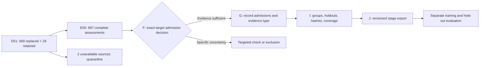

# Closing the Repairable Queue Without Confusing It With Training Readiness

**Checkpoint:** 22 October 2026, D51 / E50.  
**Project:** Ghana Health AI, general-purpose Twi understanding and direct responses.  
**Scope:** Existing instruction corpus, not ASR, TTS or a new model experiment.

## The Change Since the Last Article

[Article 6](06-corpus-correction-checkpoint-20261020.md) ended at 25 pending
original work items, two older source-held meaning checks, and one focused
Twi wording question. This checkpoint processes that entire remaining D batch,
revises both older held targets, and records the user's focused answer.

| Measure | Previous | Current |
| --- | ---: | ---: |
| Original queue sources | 699 | 699 |
| Distinct replaced originals | 646 | 669 |
| Retained complete examples | 28 | 28 |
| Unresolved D source items | 25 | 2 |
| Complete current handoffs | 674 | 697 |
| Scoped same-agent passes to admission review | 671 | 697 |
| Current E source holds | 2 | 0 |
| Current focused wording checks | 1 | 0 |
| Explicit corrected-English derivatives | 122 | 147 |
| Training admissions | 0 | 0 |

The reconciliation is **669 + 28 + 2 = 699**. Reworking two earlier targets
does not increase the source count. The working collection still contains
52,002 sources, including 26,509 protected/excluded records whose contents and
split identities remain unchanged. The separate 24,790-source uninspected
sampling pool is not covered by this targeted correction result.

## Why the Last Records Needed More Than Translation

Several English references carried defects of their own. Literal translation
would faithfully preserve the wrong supervision. Examples included inaccurate
historical dates, unsupported statistical claims, an unfinished research report,
a universal fluid-intake recommendation, and claims that depended on missing
portions, geography, prices or permissions.

The correction contract therefore keeps four things separately visible:

1. The immutable original source and English reference.
2. The diagnosed conflict, including the exact affected source text.
3. An explicitly authored corrected-English answer with bounded evidence.
4. The full Twi target compared against both the original and the derivative.

This does not permit arbitrary rewriting. The source instruction and supplied
input remain bound to the original. A correction may qualify an unsupported
claim or ask for missing information; it may not silently substitute a different
task and count that as recovery.

For the historical food-industry report, the replacement uses a dated official
US expenditure series, clearly limits its geographic and temporal scope, and
distinguishes spending from food quantities, employment and causal effects.
The original unsupported figures remain visible in the audit, not in the
proposed training answer. This is an attributed derivative, not a claim that
the original report has been independently reproduced.

For food and zoological examples, preserving entity identity mattered more than
inventing localised names. Some English food or species identifiers remain in
otherwise Twi explanations. That is an explicit coverage limitation to account
for in the mixture, not a reason to replace one species or ingredient with
another merely to make every token look Twi.

## Two Older Holds, Two Full Revisions

The first earlier hold concerned outsourcing. A source described handing work
to a provider in a way that could imply automatic transfer of legal liability.
The revised report keeps all five benefits but makes them conditional, separates
delegated tasks from accountability, and retains oversight. An official US
payroll example supports rejecting an automatic universal transfer; it is not
presented as a statement of Ghanaian tax law.

The second concerned travel. The full seven-day, 24-activity itinerary survives,
but the answer now makes the demanding four-city pace and restricted tour access
explicit. It does not assert tickets, reservations, current opening hours or
available flights. This matters for future tool-use training: a plausible plan
is not an executed action or verified external result.

Both targets receive fresh exact-version assessments. Their earlier reviews are
preserved as history, not reused to approve changed text.

## What the Human Confirmation Actually Means

The user confirmed three specific adjective glosses in a vocabulary exercise.
The record binds the exact question, response, phrases, source identity and
target hash. It resolves that focused uncertainty. It does not mark the other
seven glosses, the full example or the dataset as human-approved.

This distinction is essential for an honest dataset card. A human correcting
one phrase and an agent checking a complete answer are different evidence types.
They should not collapse into a generic reviewed flag.

## Why Two Records Remain Outside Training

One example asks for a summary of a specific linked article; another supplies
purported related URLs. The relevant article contents or proposed links could
not be verified. Inventing a summary or replacing the URLs with plausible-looking
ones would create the same data problem the repair process is meant to solve.

Both originals remain unchanged and quarantined. Failed retrieval is not proof
that a page never existed. A release can explicitly exclude these two sources;
their recovery need not hold the other candidates hostage.

## Verification and Its Limits

The D and E builders reconstructed their outputs and checked source, reference,
target, split and evidence identities. Ten new regression checks cover this
closeout's known defects, list and meal completeness, numeric controls, earlier
review preservation and phrase-only feedback. All 671 previously passing E48
reviews carry unchanged. The changed decisions are the two revised targets and
the Paris phrase-check outcome.

The full instruction regression suite passes 427 tests, including the ten new
closeout checks. Missing local diagram dependencies and a pinned PHP execution
image initially prevented four tests from running; restoring those prerequisites
allowed the suite to complete. That result measures the tested software
contracts, not Twi fluency.

All four new D50/E49/D51/E50 checkpoint packages are copied to private Modal
storage. Every remote file was read and hashed against the local package:
**36 matching artifact files**, not merely four successful upload requests.
Earlier packages remain available. The application repository and this article
repository contain public code or aggregate documentation, not private corpus
rows, recordings, credentials or review journals.

The authenticated review service now exposes the same D51/E50 queue and execution
map. Access-control, checksum and desktop/mobile checks passed without writing a
review. The persisted review journal's hash is unchanged after publication.

The 697 passes are **same-agent source comparisons**, not an independent native
evaluation, a clinical certification or a population error-rate estimate.
Structural tests and cryptographic hashes establish reproducibility and
integrity; they do not prove semantic truth or naturalness.

## What Happens Next

The immediate next step is a bounded admission decision, not another round of
the same D work. It must keep task types distinct: the current handoff includes
355 language exercises, 283 Twi-prose targets, 39 code exercises, 14 literal
labels, one literal structure and five legacy unlabelled items. Those counts
sum to 697, but they are not 697 natural multi-turn conversations. One older
unlabelled report gained an explicit prose type during rework; that relabelling
is not an extra source.

Final validation must address related-source grouping across collections,
holdout exclusion, language and topic coverage, and the actual token mixture.
Two related UN histories in the new batch are a concrete grouping case. The
language-learning, bilingual, conversation and specialised-action collections
still need their own release decisions. Finishing one repair queue does not
finish all four.

There is **no new model benchmark or training result** in this update.
[Article 4](04-benchmarks.md) and its historical measurements remain unchanged.
The gain is better-defined, reproducible supervision for the next run. Whether
it improves the model must be measured on held-out tasks after training.

## Evidence and Review

See the [dated checkpoint metadata](evidence/checkpoint-20261022.json),
[evidence ledger](evidence/README.md), authenticated
[complete-example review](https://ghanahealth.serendepify.com/research/corpus/?collection=responses)
and [execution map](https://ghanahealth.serendepify.com/research/corpus/progress).
The article is a dated research account; the hosted view may advance later.
